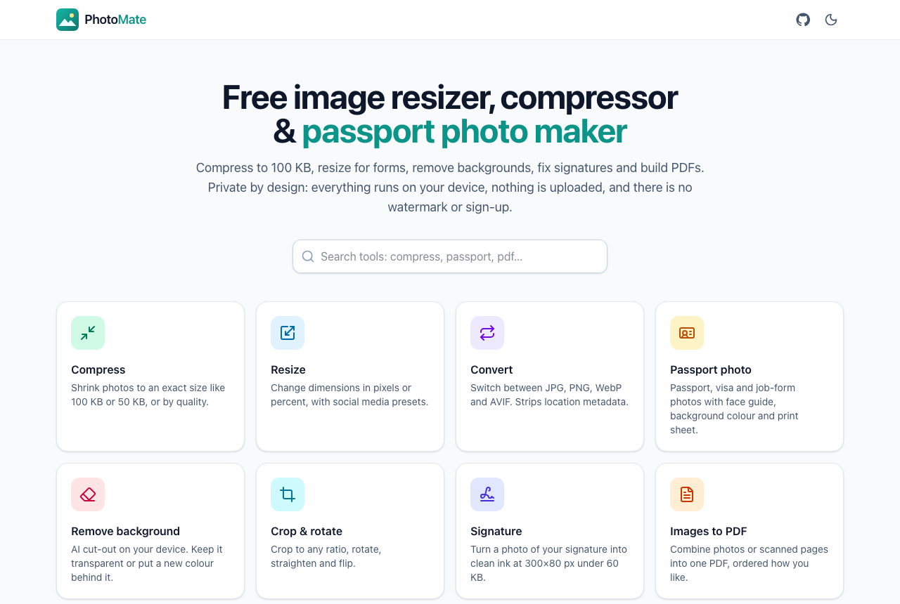
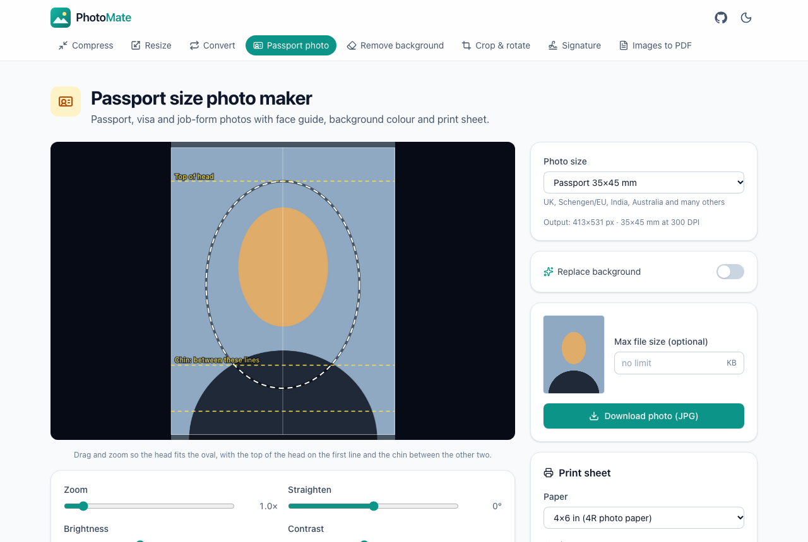
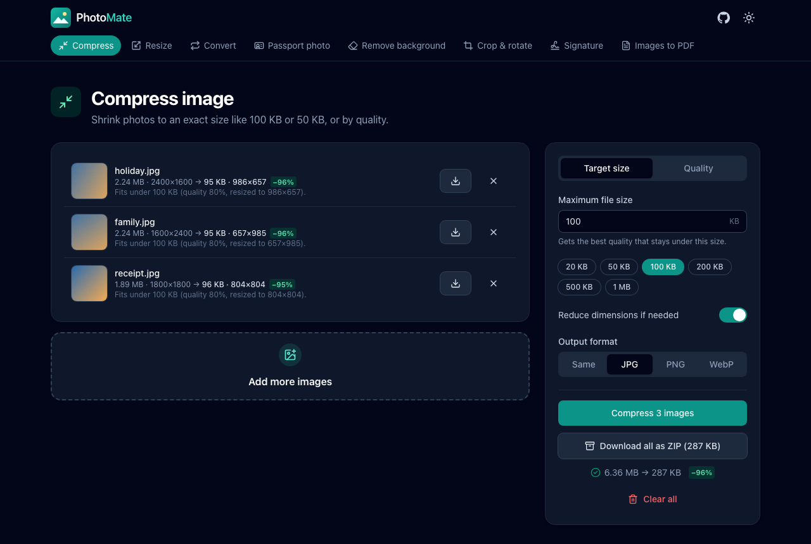
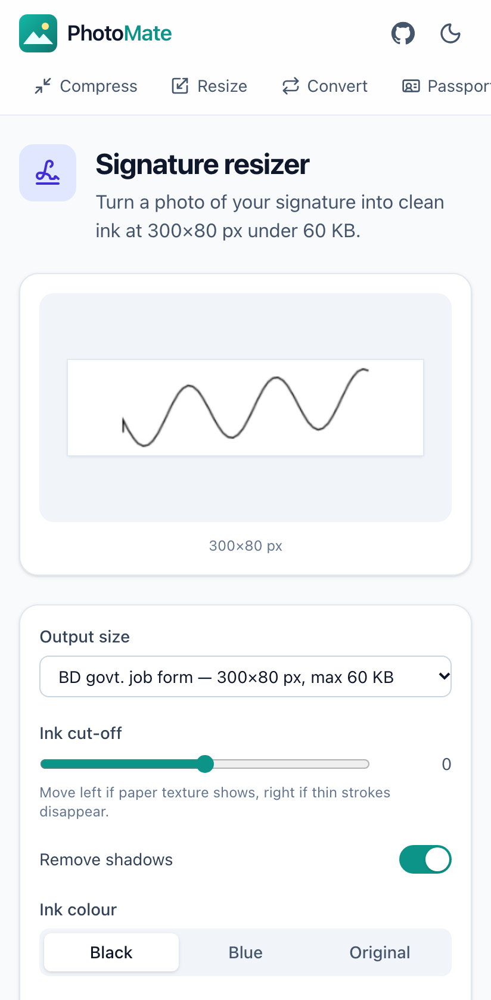

<div align="center">


# PhotoMate

**Free image resizer, compressor and passport photo maker that never uploads your photos.**

Compress to an exact KB size, resize, convert, crop, remove backgrounds, make passport and job-form photos,
clean up signatures and turn images into PDFs. Everything runs in the browser.

[**Open the app →**](https://arafatsheikh098.github.io/photomate/)

[](https://github.com/arafatsheikh098/photomate/actions/workflows/ci.yml)




</div>

## Why

Online forms want _"photo 300×300 px, max 100 KB"_ and _"signature 300×80 px, max 60 KB"_. Visa portals want
35×45 mm on a white background. Most websites that do this upload your face and ID documents to a server,
add watermarks or ask you to sign up. PhotoMate does all of it on your own device, for free, and keeps working offline.

## Tools

| Tool | What it does |
| --- | --- |
| **Compress** | Hits a target size (20 KB … 1 MB) at the highest quality that fits, or compresses by quality. Batch + ZIP. |
| **Resize** | Pixels, percent or longest side. Lock the aspect ratio, or give an exact size and crop, pad or stretch. Social presets. |
| **Convert** | JPG ⇄ PNG ⇄ WebP (⇄ AVIF where the browser supports it). Choose the backdrop colour for transparency. Strips EXIF/GPS. |
| **Passport photo** | 35×45 mm, 2×2 in, Canada, China, Malaysia, US DV lottery, BD govt. job form (Teletalk) or a custom size. Includes a face-position guide, AI background replacement, brightness/contrast, a max-KB limit and a print sheet for 4×6 in, 5×7 in, A4 or Letter (JPG or exact-size PDF). |
| **Remove background** | On-device AI cut-out. Keep it transparent, or put a colour, a blurred copy or another photo behind it. |
| **Crop & rotate** | Ratio presets, zoom, fine straightening, 90° turns and flips. |
| **Signature** | Turns a phone photo of a signature into clean black/blue ink on white or transparent, auto-trimmed to 300×80 px under 60 KB. |
| **Images to PDF** | Reorder and rotate pages. A4/Letter/fit-to-image, margins, and three quality levels to control file size. |

<p align="center">
  
  
</p>
<p align="center">
  
</p>

## How it works

- **No server.** The site is static files on GitHub Pages. Images are decoded with `createImageBitmap`
  (EXIF orientation applied), processed on `<canvas>` and saved with object URLs. Nothing is sent over the network.
- **Exact-size compression** ([`src/lib/compress.ts`](src/lib/compress.ts)). First a binary search over encoder
  quality finds the best quality under the byte budget. If even the minimum acceptable quality is too large, the
  image is scaled by √(target / size), because JPEG size grows roughly with pixel count, and the search runs
  again. That is about 9 encodes, or a few more when it has to resize.
- **High-quality downscaling.** Large reductions are done in halving steps, so they don't alias the way a single
  `drawImage` does.
- **Background removal.** IS-Net segmentation running in ONNX Runtime Web (WASM) via
  [`@imgly/background-removal`](https://github.com/imgly/background-removal-js). The model (≈55 MB) is fetched
  once, then cached by the service worker for offline use.
- **Signature cleanup** ([`src/lib/signature.ts`](src/lib/signature.ts)). Shadows are removed by dividing the
  image by a heavily blurred copy of itself. Otsu's method then picks the ink/paper threshold, and a soft ramp
  keeps stroke edges anti-aliased. The trim uses row/column ink counts so dust specks don't stretch the crop.
- **Print sheets** ([`src/lib/layout.ts`](src/lib/layout.ts)). The photo is packed on the paper in both
  orientations and the layout that fits more copies wins. The sheet is rendered at 300 DPI and exported as an
  exact-size PDF, so "Actual size" printing gives true millimetres.
- **Findable.** Each tool has its own URL (`/passport-photo/`, `/compress-image/` …). At build time a real HTML file is
  generated for each one, with its own title, description, canonical link and social preview, plus `sitemap.xml` and
  `robots.txt`. Search engines can index every tool, even though GitHub Pages only serves static files.
- **Offline PWA that never goes stale.** Installable. Every tool is a lazily loaded route chunk, so the first page
  load stays small. The service worker caches the rest in the background so every tool works without a connection.
  Each build publishes a `version.json`. Open tabs compare it with their own build: an idle tab reloads itself, and a
  tab with an image open shows a "new version" bar instead. Visitors never keep running an old cached build.
- **Large photos.** 48–200 MP phone shots are scaled once at decode time to the browser's canvas limit (16.7 MP on
  iOS). Crops allocate only the cropped region.

## Tech

React 19 · TypeScript · Vite · Tailwind CSS v4 · react-easy-crop · pdf-lib · fflate · ONNX Runtime Web ·
vite-plugin-pwa · Vitest · Playwright · GitHub Actions → GitHub Pages

## Development

```bash
npm install
npm run dev        # http://localhost:5173/photomate/
npm test           # unit tests (Vitest)
npm run e2e        # end-to-end tests in Chromium, WebKit (Safari) and phone viewports; run `npx playwright install chromium webkit` once
npm run build      # type-check + production build into dist/
```

The end-to-end suite runs every tool in Chromium and WebKit, on both desktop and phone viewports, against the
production build. It checks the actual output files: dimensions, the KB limit, PDF page count and orientation, and
ZIP contents. It also covers 48 MP photos and the crawlable per-tool pages. Test images are drawn
in the browser, so the repo holds no binary fixtures.

### Deploying your own copy

1. Fork the repo, then under **Settings → Pages** set **Source: GitHub Actions**.
2. Push to `main`. The workflow tests, builds with `BASE=/<repo-name>/` and deploys. Canonical URLs and the sitemap
   use `https://<owner>.github.io`; set `SITE_ORIGIN` for a custom domain.

For a custom domain or a root deployment, build with `BASE=/ npm run build`.

## Project layout

```
src/
  lib/          pure image logic (geometry, compression search, layout, signature, pdf) + unit tests
  components/   shared UI: dropzone, batch runner, crop stage, compare slider, controls
  tools/        one lazily loaded page per tool, plus the registry that drives routing and the home grid
e2e/            Playwright specs and in-browser fixture generation
```

## Privacy

PhotoMate has no backend, analytics or cookies. The only network request beyond the site itself is the one-time
download of the background-removal model from IMG.LY's CDN. It happens only when you use that tool, and it
downloads model weights; your image is never sent.

## License

[AGPL-3.0](LICENSE). The background-removal library is AGPL-licensed, so the app is too. You may use, modify
and host it; if you distribute or host a modified version, publish its source under the same license.

Passport and visa specifications change. Check the issuing authority's current requirements before you submit.
